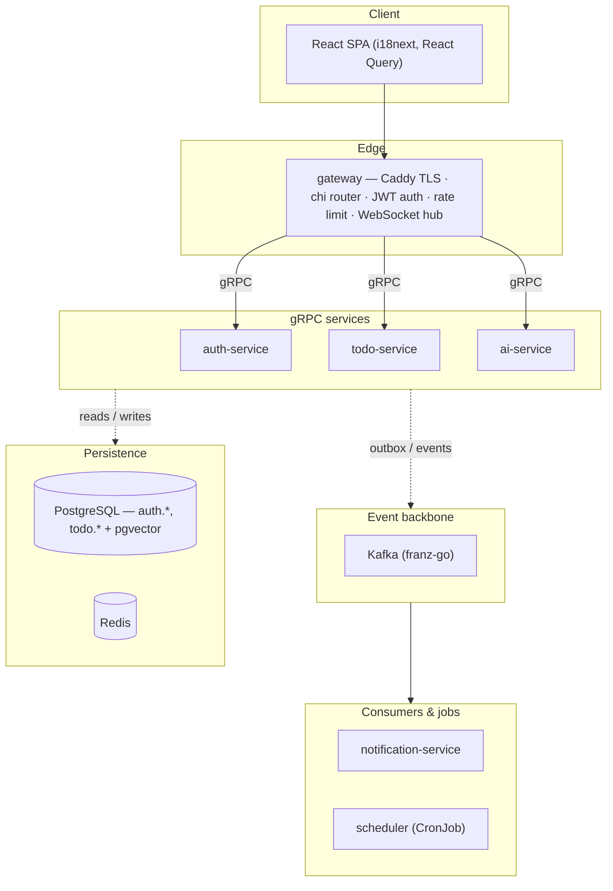

<p align="center">
  
</p>

<h1 align="center">taskdesk</h1>

<p align="center">
  A production-shaped Go microservices task-management SaaS — AI daily planning, semantic
  search, real-time sync, and a Stripe-powered pro tier, running on Kubernetes.
</p>

<p align="center">
  
  
  
</p>

---

`taskdesk` is a **greenfield Go microservices monorepo** built as a learning vehicle for
production-grade distributed systems — the task app is the surface, the real subject is gRPC,
Kafka, Kubernetes, and AI integration done the way a real product would do it: graceful shutdown,
connection-pool hygiene, transactional outbox delivery, and backward-compatible migrations.

The full set of architecture decisions, service conventions, and hard rules ("don't do X") lives
in [`CLAUDE.md`](./CLAUDE.md) (see [Documentation](#documentation)).

## Features

- **Auth** — email/password (Argon2id) + Google/Discord OAuth, RS256 JWTs (access token in
  memory, refresh in an HttpOnly cookie), session listing/revocation with device + IP tracking,
  password reset and email verification.
- **Tasks, lists & groups** — full CRUD with soft delete/restore/purge, drag-to-reorder lists and
  groups, subtasks with progress rollup, task dependencies modeled as a DAG.
- **AI-powered** — natural-language task creation, a daily prioritization plan streamed over SSE,
  semantic search (pgvector + Voyage embeddings for pro users, Postgres full-text search fallback
  for everyone else), and an async task-completion-probability score enriched via Kafka.
- **Monetization** — free/pro plans, Stripe Checkout + webhook-driven subscription state, promo
  code redemption.
- **Real-time** — per-pod WebSocket hub (with slow-consumer eviction) fanned out through Redis
  pub/sub, plus transactional email notifications (Mailpit in dev).
- **Multilingual by design** — English + Simplified Chinese across the entire stack, backend and
  frontend, from day one of any new feature.
- **Observability** — structured logs through the ELK stack, Prometheus + Grafana dashboards,
  trace IDs propagated through every hop.
- **Contract-first APIs** — protobuf source of truth (`proto/`) generating Go service stubs; the
  gateway is the only service that ever speaks HTTP to a browser.

## Architecture



| Service | Responsibility |
|---|---|
| [`services/gateway`](services/gateway) | HTTP edge: routing, local JWT verification (cached signing key), rate limiting, WebSocket hub |
| [`services/auth`](services/auth) | Users, JWTs, OAuth, sessions, subscriptions/Stripe, password/email flows |
| [`services/todo`](services/todo) | Tasks, lists, groups, subtasks, dependencies, embeddings, outbox publisher |
| [`services/ai`](services/ai) | Claude-backed daily plans (SSE streaming), NL task parsing, embeddings |
| [`services/notification`](services/notification) | Kafka consumer → email + WebSocket fan-out |
| [`services/scheduler`](services/scheduler) | CronJob that triggers daily plan generation per user |
| [`web`](web) | React 18 + Vite + TypeScript SPA |

Services communicate **gRPC internally**; the gateway is the only HTTP-speaking service and the
only one exposed to the browser. `todo-service` writes Kafka events to a Postgres outbox table in
the same transaction as the state change — a background publisher drains it to Kafka every
500 ms (`acks=all`, idempotent, at-least-once). Two feedback paths aren't pictured above for
clarity: the scheduler also calls `ai-service` directly (gRPC) to kick off each user's daily plan,
and `notification-service` publishes to Redis pub/sub so the gateway's WebSocket hub can fan
real-time events back out to connected browsers.

## Stack

Go 1.25 · gRPC + protobuf · pgx/v5 (no ORM) · PostgreSQL + pgvector · Kafka (franz-go) · Redis ·
Claude API + Voyage AI embeddings · Stripe · Prometheus/Grafana + ELK · Kubernetes (kind + Tilt
locally, Kustomize manifests) · React + TS + Vite + Tailwind + i18next (frontend).

## Prerequisites

- **Go** ≥ 1.25
- **Docker**
- **kind**
- **kubectl**
- **helm** ≥ 3.14
- **Tilt**
- **Node** ≥ 20 (for the `web/` SPA)

## Getting started

```sh
git clone <this-repo>
cd todo

# 1. Create the kind cluster and load pre-pulled infra images
./scripts/kind-up.sh

# 2. Install Kafka (Strimzi operator + single-broker cluster)
./scripts/install-kafka.sh

# 3. Generate the JWT signing key secret (safe to re-run; won't rotate by default)
./scripts/gen-jwt-key.sh

# 4. Start the dev loop — compiles Go on the host, hot-syncs into kind (~2s reload)
source .envrc   # GODEBUG=netdns=cgo, GOPROXY, PATH
tilt up
```

> [!TIP]
> `tilt up` opens the Tilt UI at http://localhost:10350 with live build status and logs per pod.
> The app itself is served at http://localhost:8080 once Caddy is up.

For the web SPA in isolation:

```sh
cd web
npm install
npm run dev   # Vite dev server, proxies /api/v1 → http://localhost:8080
```

## Usage

| Command | Description |
|---|---|
| `./scripts/kind-up.sh` / `kind-down.sh` | Create / tear down the kind cluster |
| `./scripts/cluster-start.sh` / `cluster-stop.sh` | Resume / pause the cluster without discarding it |
| `./scripts/install-kafka.sh` | Install Strimzi + a single-broker Kafka cluster |
| `./scripts/gen-jwt-key.sh` | Generate (or `--force` rotate) the auth-service JWT signing key |
| `tilt up` | Start the dev inner loop (compile, sync, hot-reload) |
| `./scripts/port-forwards.sh` | Forward gateway:8080, Grafana:3000, Kibana:5601, Mailpit:8025 + Postgres/Redis |
| `./scripts/proto-gen.sh` | Regenerate `proto/gen/` from `.proto` sources |
| `./scripts/seed.sh` | Seed a default test user with sample data |
| `go test ./pkg/tokens/ ./services/gateway/...` | Unit + gateway httptest layers (no Docker) |
| `go test ./services/auth/... -timeout 120s` | Store/server integration tests (needs Docker) |

See [Testing](./CLAUDE.md#testing) in `CLAUDE.md` for the full three-layer breakdown.

## Configuration

Each service reads its secrets from a gitignored `.env` in its `deploy/k8s/base/<service>/`
directory — copy the matching `.env.example` before first run. Kustomize's
`configMapGenerator`/`secretGenerator` pick these up for both local (kind) and production
clusters, so the same variable names apply in every environment.

## Project structure

```
proto/            .proto sources + generated Go bindings (proto/gen)
pkg/               shared libs — logger, config, pgx pool factory, kafka wrappers, JWT, metrics, i18n
services/          gateway, auth, todo, ai, notification, scheduler
migrations/        per-service SQL migrations (golang-migrate style .up/.down pairs)
deploy/k8s/        Kustomize base manifests per service
deploy/strimzi/    Kafka operator manifests
infra/             Prometheus, Grafana, ELK manifests for the kind cluster
web/               React SPA
docs/              design docs and implementation plans
```

## Documentation

- [`CLAUDE.md`](./CLAUDE.md) — architecture, service conventions, ops runbook, and the
  project's hard "don't" list.
- [`docs/`](docs) — design docs and implementation plans for in-progress features.

## Contributing

Bug reports, feature requests, and PRs are welcome. See [`CONTRIBUTING.md`](./CONTRIBUTING.md)
for the branching model, code style, and testing expectations before opening a pull request.
